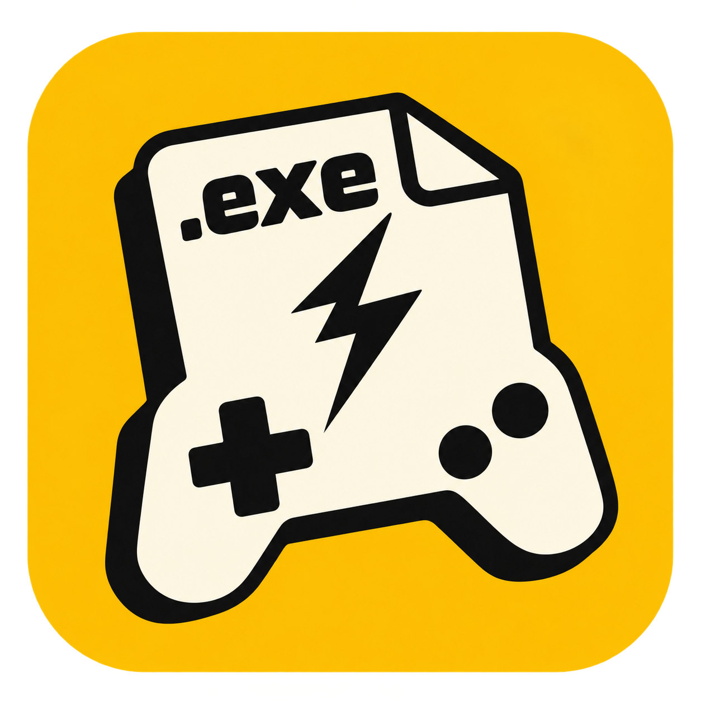

<p align="center">
  
</p>

# MacGameDeck

**A controller-friendly game launcher for Apple Silicon Macs.**

Install and launch supported Windows games from a native SwiftUI interface, with an automatically managed Wine runtime, Steam integration and a full-screen controller interface.

**Development preview · 0.15.0 · macOS 13+ · Apple Silicon**

MacGameDeck is the app name; **MacGameDock** is the repository and Xcode project name. This is an independent community project, not affiliated with Valve, Apple or CodeWeavers.

## What you can do

- Browse your Steam library, including Steam Families entries, and detect games installed locally.
- Choose an available Mac or Windows version before installing.
- Manage downloads with pause, resume, cancellation, priority, bandwidth limits and history.
- Switch between desktop and Big Picture interfaces with **⌘⇧B** or the on-screen buttons.
- Navigate with supported controllers, using device-specific button symbols and an optional Confirm/Back swap.
- Open native game pages with descriptions, player counts, supported play modes and automatically loaded achievements.
- Synchronize supported Steam Auto-Cloud saves, with backups and explicit conflict handling.
- Browse Workshop items, download mods and manage their activation.
- Use SteamGridDB covers, backgrounds and logos with your own API key.
- Follow the Mac's language automatically, or choose **English** or **Italian** in Settings.

## Getting started

### Build with Xcode

1. Clone this repository.
2. Open **MacGameDock.xcodeproj**.
3. Select the **MacGameDeck** scheme and **My Mac** destination.
4. Build and run with **⌘R**.
5. Connect your Steam account in the app and choose a game.

The Steam helper and .NET runtime are bundled. The Windows runtime and supported dependencies are downloaded automatically when needed. Rosetta 2 is required for x86 components on Apple Silicon.

The official Steam and CrossOver applications are not required by the managed launch path. A valid Steam account, game licenses and access to Valve services are still required for Steam features. Compatibility varies by game.

### Standalone builds

Development builds are signed ad hoc, without Developer ID notarization or automatic app updates. There is currently no notarized public release. Build from source if no downloadable release has been published.

`scripts/build-app.sh` produces `dist/MacGameDeck.app` in environments that support the SDK's Swift compiler plugins. Xcode is the verified build route on the development machine.

## Library and downloads

The library supports recent games, favorites, collections, hidden games and sorting. Each game page brings together installation, launch, activity, achievements, saves, Workshop and maintenance.

Download sessions are reused across launches; a revoked or expired session requires a new login. Credentials are stored in the private application data directory with file/directory permissions of 0600/0700, rather than prompting for Keychain access at startup. They are not separately encrypted from the disk. Do not share that directory.

Downloads preserve partial files when paused or cancelled. Removing a completed history entry does not uninstall the game. The optional 1/5/10/25 MiB/s limit applies to aggregate Steam content blocks at the next worker start or resume; it does not include all HTTP overhead, engine packages or cloud transfers.

Choose a folder or external drive for new installations. Managed containers can be transferred to an empty destination with hash verification while preserving the original. Transfers with registered mods are currently blocked because mod path migration is not implemented.

**Uninstall** moves game files to `Uninstalled/UUID/Game`, preserving the Windows prefix and catalog entry. It does not permanently delete data or reclaim space until the backup is removed manually. **Remove from library** preserves all files. External installations are not uninstalled by the app.

## Windows compatibility

The app downloads hash-pinned **WineCX FOSS 24.0.7_7**, supporting macOS libraries and **DXMT 0.80**. It checks Metal exports and initializes a test Windows prefix before preparing games. Container migrations back up registry files and Wine modules while preserving native Microsoft DLLs and saves.

Supported Steam redistributables and Visual C++ components are prepared automatically. DXMT supports DirectX 10/11; proprietary D3DMetal is not included. DX12-only games, anti-cheat, DRM and multiplayer may be unsupported. Native Mac games requiring the original Steamworks client are not supported by the autonomous launch path.

A running process is not proof that a game works. The app distinguishes launch detection from user-confirmed compatibility. Sektori reached its menu on the development M1 on October 22, 2026; this does not establish compatibility with other games. Requirement estimates are approximate, with no invented FPS predictions or automatically applied benchmark profiles.

## Steam Cloud, playtime and achievements

Cloud files load automatically when entering the page. For supported Auto-Cloud mappings, launch preparation compares content hashes and timestamps, downloads newer remote files into verified staging and preserves newer local files. Equal timestamps with different content or ambiguous paths require attention. Replaced copies are backed up under `Cloud/Backups`.

After a session, changed files are snapshotted and compared against the remote revision observed before launch. Concurrent changes stop synchronization rather than silently selecting a winner. Failed uploads remain in `Cloud/Pending` for retry; uploaded snapshots remain in `Cloud/Uploads`. Conflict resolution explicitly chooses the Mac or Steam copy and preserves backups. Deletions are not propagated.

Cloud support is limited to recognized Auto-Cloud paths and patterns. SDK-only cloud, complex path transforms and encrypted transfers are unsupported. Real-account tests verified inventories and a deduplicated upload cycle with unchanged content; uploading newly earned progress between two devices still needs a full real-game validation.

For compatible Windows games, a reversible Steam API bridge records achievement events, requests native notifications and journals unconfirmed submissions. Steam confirms an unlock before it is marked synchronized. GamesPlayed is sent only while the monitored process is active; playtime is read back afterwards. Offline hours are not retroactively added. Local process time and Steam-reported time remain separate.

A newly earned achievement and its full-screen notification still need per-game validation. Existing Steam data and an already-earned achievement round trip were tested on a real account. The bridge does not guarantee official-client-equivalent DRM, anti-cheat, multiplayer or Steam Input.

## Controllers and the in-game menu

Big Picture covers the library, game pages, downloads, account, cloud, Workshop, settings and logs. Search and folder selection have controller-accessible interfaces. macOS GameController supplies discovery, battery information and button symbols for supported profiles; arbitrary HID devices are not guaranteed.

**Home** opens the session menu; holding **Menu** for 1.2 seconds is the fallback when macOS reserves Home. The menu shows session time and achievements, provides resume/exit actions and links to system controller remapping. The game continues running while the menu is open, and some runtimes may still receive controller input.

Launching a game attempts to transfer focus and use the display containing MacGameDeck. Accessibility permission is requested only through the explicit window-management action. Exclusive full-screen games may refuse movement or cover external panels. Screen Recording permission is not required. Confirm/Back swapping affects the launcher, not game controls.

## Artwork and Workshop

Configure a personal [SteamGridDB API key](https://www.steamgriddb.com/profile/preferences/api) in Settings → Covers and backgrounds. The key stays in the private credentials directory and is never sent to image CDNs. Assets include author attribution; the managed disk cache is limited to 256 MiB. Steam artwork or a placeholder is used as fallback.

Workshop browsing and downloads use native views. Mods are copied to a new folder selected for the game; disabling moves them out, and re-enabling refuses to overwrite existing content. Loaders, dependencies, update management and load order remain manual. Having files installed does not prove that the game has loaded a mod.

## Development and verification

- Swift/SwiftUI application: `Sources/MacGameDock`
- Logic tests: `Tests/MacGameDockTests`
- Steam helper and corresponding source: `Helpers/SteamDownloader/Source`
- Steam bridge source archive and notes: `Helpers/SteamBridge`
- Icon source and saved concepts: [Branding](Branding/README.md)

The latest recorded 0.15.0 validation passed **137 Swift tests**, with **5 skipped** and no failures, plus the C# protocol regressions and a native Xcode Release build. The logic harness omits SwiftUI views because the restricted shell cannot run the Xcode 27 SwiftUI macro plugin; Xcode compiles those views separately. These checks do not certify every game or hardware configuration.

Run the helper regressions after restoring its pinned dependencies:

```sh
dotnet run --project Helpers/SteamDownloader/Tests/SteamProtocolRegression.csproj
```

For isolated app testing, set `MACGAMEDOCK_DATA_DIRECTORY` to an absolute test directory. Normal data lives in `~/Library/Application Support/MacGameDock/`. Logs redact recognized credentials; inspect exports before sharing them.

## Current limitations

Full Epic/GOG login and autonomous downloads, automatic game updates, measured FPS, verified per-game graphics profiles, virtual controllers and per-game input profiles are not implemented. A complete VoiceOver and keyboard accessibility audit remains outstanding.

See the [documentation index](docs/README.md), [latest implementation report](docs/implementation-status-0.15.md) and [historical notes](docs/history-through-0.9.7.md). Historical reports describe their own versions and are not current feature promises.

## Open-source components

DepotDownloader 3.4.0 / SteamKit2 modifications and corresponding source are included. `integration.patch` targets the upstream tag; `patch-upstream.py` recognizes already-patched source. Rebuilding the helper requires .NET SDK 9; see `Helpers/SteamDownloader/build-helper.sh`.

GSE binaries include their GPL license, hashes and source archive. Wine, DXMT and supporting libraries have [runtime source notices](Sources/MacGameDock/Resources/RuntimeNotices/SOURCES.md). The .NET runtime includes its own license and third-party notices. Upstream license texts are preserved.

## Feedback

When reporting a problem, include your Mac chip, macOS version, app version, game/store, chosen platform, reproduction steps and a redacted log excerpt. Distinguish “process started” from “reached the menu” and “played successfully.” Never attach sessions, tokens or private saves.
